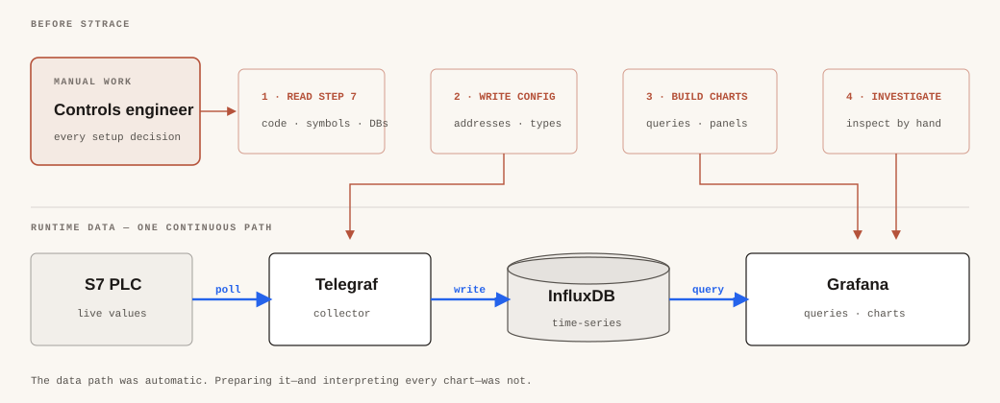
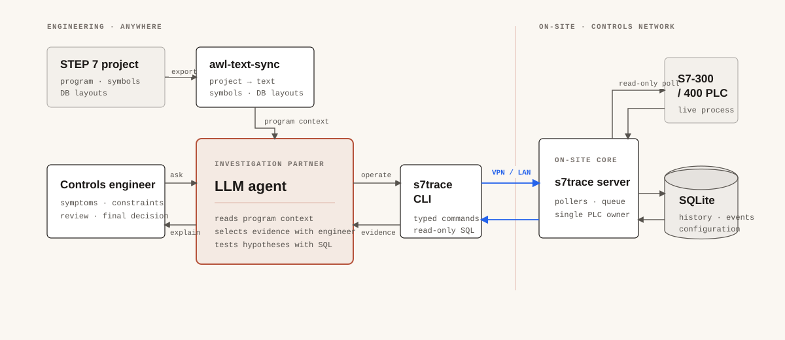
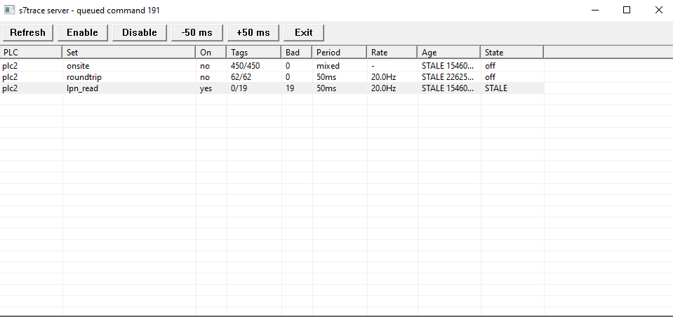

# s7trace

[](https://github.com/ArthurkaX/s7trace/actions/workflows/ci.yml)
[](LICENSE)

> **Disclaimer:** This is an independent third-party tool. It is not an official
> Siemens product and is not affiliated with, sponsored by, or endorsed by
> Siemens. It is provided "as is" and does not replace official engineering,
> diagnostic, or safety procedures.

**A read-only black box for investigating intermittent faults in Siemens
S7-300/400 systems.**

`s7trace` continuously polls a focused set of PLC addresses and records their
history in a portable SQLite database. It can stay on site for hours, days, or
weeks until a rare fault happens again. When it does, you investigate the actual
sequence of events before, during, and after the failure—not an operator's
recollection or a normal-looking online snapshot taken too late.

The engineer does not have to remain on site. The `s7trace server` stays next to
the PLC on an industrial PC or service laptop, while the same small executable
acts as a remote CLI. From another office or another city you can check whether
data is fresh, change a diagnostic set, perform a one-off read, add an event
note, and query the history without opening a remote desktop session or creating
a second connection to the PLC.

This is not a SCADA package and not another visualization stack. Its narrower
job is to provide the evidence that is usually missing when an intermittent
industrial fault has to be explained.

> `s7trace` is currently intended for Siemens S7-300/400 PLCs. It is read-only
> by design and never writes values to PLC memory.

## The problem it solves

Intermittent faults tend to disappear before an engineer reaches the machine.
They may occur once a week, only at night, or only under a rare combination of
states. By the time somebody connects STEP 7, the current values are normal,
diagnostic buffers are limited, and reproducing the condition on production
equipment may be impossible or unsafe.

Without continuous recording, the investigation becomes guesswork:

- Which signal changed first?
- Was it a cause or a consequence?
- How long did the intermediate state last?
- Has the same transition sequence occurred before?
- What were the neighbouring mechanisms doing at that moment?

With `s7trace`, you select only the signals relevant to the current hypotheses,
choose their polling periods, start a named dataset, and leave the recorder
running. When the problem returns, the complete timeline is still in SQLite.

This is especially useful for remote support. A short site visit may be enough
to place the recorder safely in the controls network; the rest of the
investigation can happen through compact CLI commands. The on-site server owns
the only PLC connection. Remote clients talk to `s7trace`, never directly to the
CPU.

## Why I built it

About a decade ago I saw a process historian on a site for the first time and
immediately understood how I wanted to work from then on. I used STEP 7
Analyzer, iba, and later the free Telegraf → InfluxDB → Grafana stack. Continuous
monitoring repeatedly gave me the evidence needed to solve the most difficult
and elusive faults.



The arrival of capable LLMs changed the two most labour-intensive parts of that
workflow. There is no longer a good reason to copy hundreds of addresses by
hand, nor to inspect every time-series manually.

I export the original STEP 7 project with another tool I created,
[`awl-text-sync`](https://github.com/ArthurkaX/awl-text-sync). I discuss the
symptoms and possible causes with an LLM, review a minimal set of diagnostic
tags, and leave `s7trace` collecting until the fault appears again. The LLM can
then help construct SQL queries, compare transitions, calculate durations, and
test hypotheses against the recorded database.

## How the engineer, LLM, project, and recorder work together

The engineer talks to one LLM agent throughout the investigation. The agent
combines two different views of the same machine:

- the **static view**—program logic, symbols, DB layouts, and cross-references
  exported from the STEP 7 project by `awl-text-sync`;
- the **runtime view**—current status, selected signals, event notes, and
  recorded history obtained through the remote `s7trace` CLI.



The key point is that the agent does not infer the machine state from the
program alone. It can compare what the project says *should* happen with what
the recorder proves *did* happen. The engineer remains responsible for the
hypothesis, tag selection, safety, and final decision.

The LLM does not replace the controls engineer and receives no ability to
control the PLC. It helps read the program, design the observation, and analyse
recorded evidence. Configuration changes go through typed `s7trace` commands,
history is exposed through bounded read-only SQL, and only the server owns the
PLC connection.

## What s7trace provides

- Continuous polling of one or more S7-300/400 PLCs.
- Thematic metric sets for a drive, conveyor, handshake, sequence, or fault.
- Independent polling groups with different periods.
- Change history, poll cycles, and diagnostic events in SQLite.
- Live tag and set changes without restarting the server.
- One-off typed and raw reads for address diagnostics.
- Timestamped notes that align operator observations with PLC data.
- Visibility into bad tags, stale polling, and queue state.
- Compact JSON/JSONL output for scripts and LLM agents.
- Full remote operation through the CLI and a durable command queue.
- A small native Windows control window for set state and polling freshness.

SQLite is deliberate: one file holds configuration, history, events, and queue
state. It is easy to copy, archive, inspect with standard tools, or give to an
LLM agent under read-only access.

### On-site control window

On Windows, the server includes a deliberately small local panel for checking
metric sets, active and bad tag counts, effective polling rate, and data age.
It can enable or disable a selected set and adjust a single poll group's period.
The CLI remains the full local and remote engineering interface.



## Typical workflow

1. Export the STEP 7 project with `awl-text-sync`.
2. Describe the symptoms and identify signals that distinguish the main
   hypotheses.
3. Add the PLC, polling groups, and diagnostic tags to `s7trace`.
4. Leave the server on site and operate the recording remotely through the CLI.
5. Wait for the fault to recur.
6. Query SQLite for event boundaries, transition order, durations, and similar
   episodes.
7. Verify the conclusion against the PLC program and the physical process.

Do not record everything merely because it is available. A small signal set
chosen to separate concrete hypotheses puts less load on the PLC and produces a
far clearer investigation.

## Quick start

### Build

A stable Rust toolchain is required:

```sh
cargo build --release
```

The main binary is written to `target/release/s7trace` (`s7trace.exe` on
Windows). The build also produces `s7mock`, a mock PLC server used for testing.

### Start the on-site server

```sh
# Server, SQLite database, HTTP CLI transport, and Windows control window
s7trace --db s7trace.db server

# Headless, with the CLI transport bound to localhost only
s7trace --db s7trace.db server --noui --http-bind 127.0.0.1:7707
```

Port `7707` is the default CLI transport port. The server is the only process
that polls PLCs and writes the live database; action commands are serialized
through its durable queue.

### Work remotely through the CLI

The two roles are intentionally separated:

```text
SITE                                               ENGINEER

S7-300/400 ← s7trace server ← VPN/private network → s7trace CLI
                  ↓                                      ↓
              SQLite file                         human or LLM agent
```

Only `s7trace server` must remain on site. The engineer needs the same executable
and uses `-r` to route commands to that server:

```sh
# Check the recorder from another city
s7trace -r s7trace-site.example status

# Return current problems in an LLM-friendly format
s7trace -r s7trace-site.example sql --format jsonl \
  "SELECT * FROM v_tag_status WHERE bad = 1"

# Enable a prepared diagnostic set
s7trace -r s7trace-site.example set-enable intermittent_fault

# Put an operator report on the same timeline as the PLC samples
s7trace -r s7trace-site.example note "The stop occurred again" \
  --plc line1 --dataset incident_2026_07
```

Set `S7TRACE_SERVER` to avoid repeating `-r`; use `S7TRACE_PORT` or
`--server-port` for a non-default port. A bare host, `host:port`, and a full
`http://host:port` URL are accepted.

Do not expose port `7707` directly to the public Internet. Use a VPN or another
protected private network and enable `S7TRACE_TOKEN`.

### Configure a recording

The addresses below are examples. Replace them with values reviewed for your
PLC.

```sh
# Define a PLC and a 100 ms polling group
s7trace -r 127.0.0.1 plc-add --name line1 \
  --host 192.168.0.50:102 --rack 0 --slot 2
s7trace -r 127.0.0.1 poll-group-add --name fast --period-ms 100

# Create a focused set and add a validated tag
s7trace -r 127.0.0.1 set-create --plc line1 --name intermittent_fault
s7trace -r 127.0.0.1 tag-add --plc line1 --name Motor.Speed \
  --address DB1.DBW0 --type i16 --poll-group fast --set intermittent_fault

# Start a named investigation dataset
s7trace -r 127.0.0.1 collection-start --plc line1 \
  --dataset incident_2026_07 --set intermittent_fault

s7trace -r 127.0.0.1 status
```

Tags can also be imported from a small YAML-shaped signal file:

```yaml
signals:
  - name: Motor.Speed
    address: DB1.DBW0
    type: i16
  - name: Conveyor.Running
    address: DB1.DBX10.0
    type: bool
```

```sh
s7trace -r 127.0.0.1 tag-import --plc line1 --file signals.yaml \
  --set intermittent_fault --poll-group fast --validate
```

### Query the recorded evidence

Query a running remote server:

```sh
s7trace -r 127.0.0.1 sql --format jsonl \
  "SELECT * FROM v_tag_status WHERE bad = 1"
```

Inspect a stopped or copied database offline:

```sh
s7trace --local-db --db s7trace.db sql \
  "SELECT name, last_value_i FROM tag"
```

The `sql` command accepts read-only `SELECT`, `WITH`, and `PRAGMA` statements,
applies a row limit, and has a timeout. This is a practical boundary for LLM
tools: ask the agent to inspect the schema and construct narrow queries instead
of dumping the entire time-series into its context.

Run `s7trace --help` for all commands and `s7trace <command> --help` for one
command's exact options.

> **Possible next step:** I am considering a small chart workflow in which a
> CLI command requests a time window and a chosen set of tags, then opens a
> local web view containing the resulting plots. This is a roadmap idea, not a
> feature in the current release; configuration, collection, and analysis are
> CLI/SQL-driven today.

## Operational safety

Although `s7trace` never writes PLC memory, cyclic reads still consume CPU
communication resources. Begin with a small number of tags and conservative
periods, watch the status, and expand gradually. Be particularly careful with
old or already heavily loaded controllers.

If port `7707` is reachable beyond localhost, set the same `S7TRACE_TOKEN` value
for the server and every client. When the variable is unset or empty,
authentication is disabled.

```sh
# Server process
S7TRACE_TOKEN=change-me s7trace --db s7trace.db server

# Remote client process
S7TRACE_TOKEN=change-me s7trace -r s7trace-site.example status
```

Do not publish production SQLite databases. They may contain equipment names,
program structure, PLC addresses, timestamps, and process data.

## Architecture

```text
PLC → pollers → current-value snapshot → SQLite
                         ↑                 ↓
                    server/queue ← CLI / read-only SQL
```

- The per-PLC actor owns the PLC connection and serializes all reads.
- SQLite stores configuration, history, events, and command state.
- The CLI is the interface for both engineers and LLM agents.
- Metric sets define focused groups of signals.
- Datasets separate one investigation from another.

See [`docs/architecture.md`](docs/architecture.md) for implementation details.

## Further reading

- [`docs/concept.md`](docs/concept.md) — design principles and scope.
- [`docs/architecture.md`](docs/architecture.md) — data flow and components.
- [`docs/server-ui.md`](docs/server-ui.md) — native Windows control window.
- [`docs/cli-ergonomics.md`](docs/cli-ergonomics.md) — proposed CLI improvements.
- [`docs/spike-multiread-chunking.md`](docs/spike-multiread-chunking.md) — S7
  multi-read batching and PDU constraints.
- [`docs/schema.sql`](docs/schema.sql) — canonical SQLite schema.

## Project status

This began as my own field troubleshooting tool and is published for engineers
who find the same workflow useful. Interfaces and the database schema may still
change. The default S7 backend uses the vendored pure-Rust `turbos7` client; a
native Snap7 dependency is not required for the normal build.

Some repository scripts can use a separately obtained local Snap7 server to
simulate a PLC during development. The `snap7/` directory is ignored, Snap7 is
not bundled or distributed with `s7trace`, and it is not required at runtime.

## License

`s7trace` is released under the [MIT License](LICENSE). The vendored `turbos7`
dependency retains its upstream dual-license declaration; see
[Third-party notices](THIRD_PARTY_NOTICES.md).
